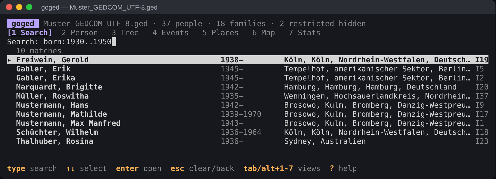
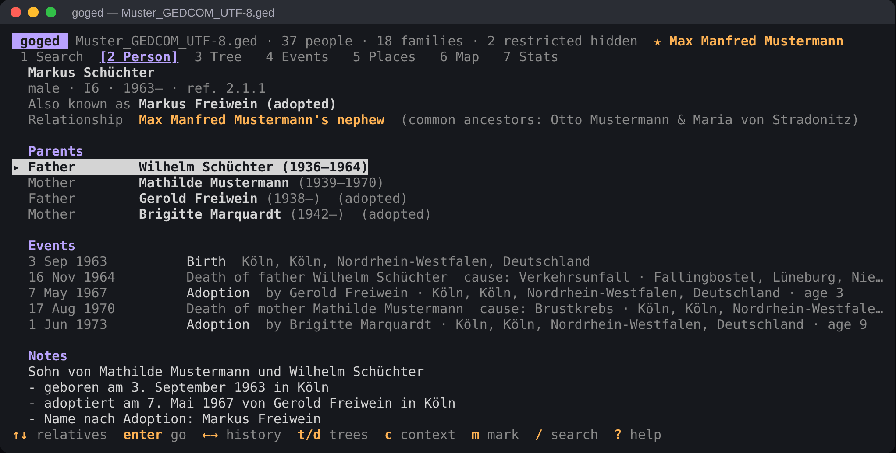
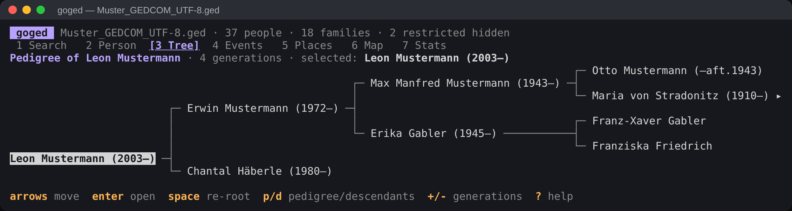
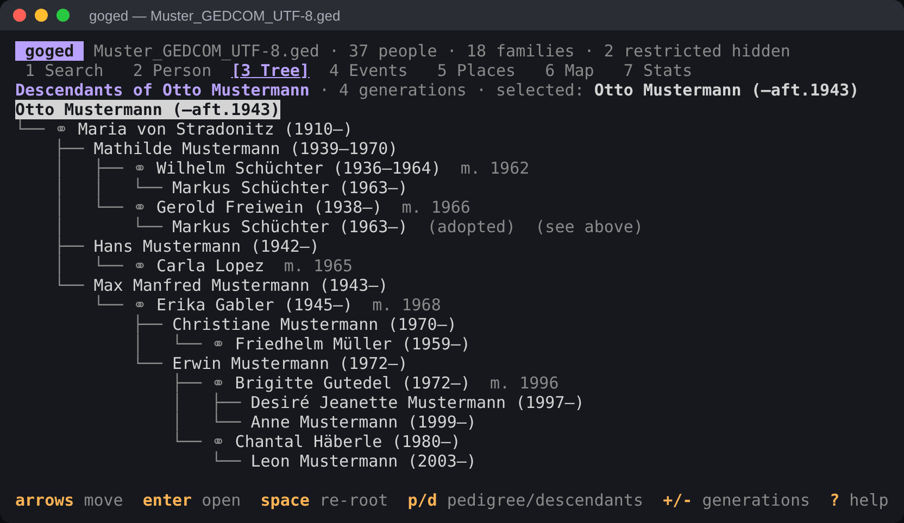
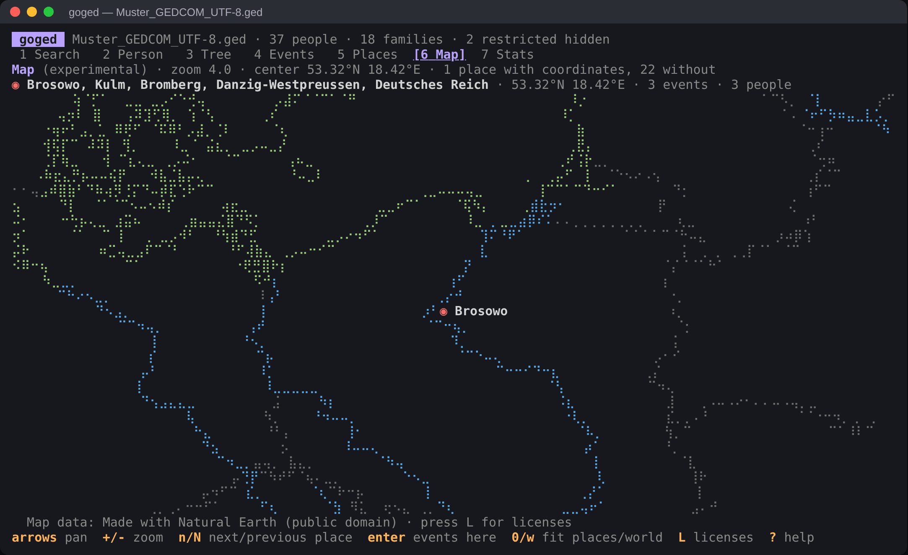

# goged

A fast terminal browser for [GEDCOM](https://gedcom.io/) genealogy files.
Search people by name and any other property, read their life events in
order, jump between relatives, and explore pedigree and descendant trees and
the lifespans of a family — from the keyboard, or with the mouse.

The screenshots below use the [GEDCOM-L sample file](testdata/Muster_GEDCOM_UTF-8.ged).

\
*Search with a year range; results show lifespans and birth places.*

\
*Person view with the relationship to a marked reference person, and birth and adoptive parents.*

\
*Pedigree chart of ancestors.*

\
*Descendant chart with spouses, marriage years and an adopted child.*

\
*The experimental map shows places that have coordinates.*

## Features

- **Search as you type** over names (diacritic-insensitive, alternate and
  married names included, phonetic matching) and over any other
  property: dates, places, occupations, notes, sources, arbitrary GEDCOM tags.
- **Person view** with parents, siblings and half-siblings, every family with
  spouse and children, associated people (godparents, witnesses, friends:
  `ASSO`, `_ASSO`) and records that may describe the same person (`ALIA`),
  notes and sources with quoted text. All relatives are links: move the
  cursor and press enter to jump; go back and forward like in a web browser.
- **Life timeline** of important events in chronological order, with the
  person's age at each event, optionally interleaved with the births,
  marriages and deaths of close relatives during their lifetime.
- **Charts**: a horizontal pedigree chart of ancestors, an indented
  descendant chart with spouses, and an hourglass of both like a bowtie
  (descendants to the left, ancestors to the right), all navigable with the
  arrow keys, re-rootable, and adjustable from 2 to 20 generations. Ancestors who
  appear more than once in a pedigree, as after a marriage between cousins,
  have their own ancestors drawn only once; elsewhere these read "truncated
  as duplicate", and enter or space there moves them to that place.
  The **lifespans** draw the lives of a person's parents, siblings,
  partners and children as lines on a time axis, coloured while the person
  lived, with marriages, approximate dates and lives whose end (or
  beginning) is not recorded; on the right how long each lived at the same
  time as the person, or was married to them. Each generation more adds
  grandparents, aunts and uncles, and grandchildren.
- **Events browser** listing all (or only the vital) events of the file in
  chronological order, with a filter for type, year range, place and names.
- **Places browser**: every place in the file arranged by jurisdiction
  (country → county → town) with the number of events and people, collapsible
  and filterable. Select a place to list everything that happened there and in
  the places within it, then open the people involved.
- **Map (experimental)**: a zoomable world map drawn with Braille characters
  from 80°N to 60°S in three projections (Equirectangular, Equal Earth, Web
  Mercator), with coastlines, country borders, rivers and lakes, the
  equator, and a marker for every
  place that has coordinates (`PLAC` → `MAP` → `LATI`/`LONG`, or the place
  record the place refers to). The map data is
  compiled into the executable, so goged stays a single file.
  The surname view (`s`) shows only the places where people born with one
  surname had events, with their number, and a panel with the surnames,
  the selected place and the surname's events per decade; `e` narrows the
  events to births, deaths or the others. From the statistics, a surname
  opens there, too.
- **Relationship calculator**: mark a reference person and every person view
  tells how they are related ("Harold Smith's third cousin", "half-great-aunt",
  "brother-in-law", "husband's aunt", "co-father-in-law", "adoptive father"),
  including the closest common ancestors. Blood relationships follow birth
  links only; adoptive, foster and step links are named as such.
- **Plausibility checks** with adjustable thresholds: born after death, born
  or died twice on different days, events before birth or after death,
  implausible ages (very old, parents too young or old, married too young),
  children born after a parent's death or too soon after a sibling, and
  people who may have been entered twice (names that sound alike, born
  close together). Imprecise dates only count where the problem is
  certain; every finding links to the people concerned. **Hints** point to
  gaps: unknown parents in the ancestry of the marked person (and how
  complete each generation is), people without a date or place of birth,
  born long ago without a recorded death, or without any events, couples
  married without a date, events without a source, and groups of place
  names that may be spellings of one (almost identical, similar or
  somewhat resembling).
- **Statistics and validation**: counts, time span, generations, lifespans,
  most common names, the events that happened on this day in earlier years,
  the pedigree collapse (the share of places in everybody's pedigree taken
  by an ancestor who is there more than once, as with married cousins), bar
  charts of births over time, ages at death and at marriage and children per
  family, and all warnings found while reading the file.
- **Export** of everybody or only the people connected to the marked person:
  - to [GEXF](https://gexf.net/) (Graph Exchange XML Format) for Gephi,
    networkx and sigma.js: people are nodes with their sex, birth and death;
    parents point to their children, and partners are linked both ways;
  - to PDF, pages to print or read: contents with indexes, a page per person
    as in the person view, then the places with their events, with page
    references that link to the pages. Nothing is cut on paper: long lines
    wrap, every column within its own place;
  - to HTML, the same contents, people and places as one web page with links
    between them, in any script the browser can show.
- **Watches the file**: when another program, such as a genealogy editor,
  has changed it, goged asks whether to load it again, and keeps the
  person, history, search, filters and settings where it can. `D` then
  lists what changed: the header (program, date of the file …), people,
  families and other records added, removed or changed, with the details.
  `goged -diff OLD.ged FILE.ged` prints the same for two versions of a file.
- **Mouse**: click to select and again to open, click the tabs, scroll with
  the wheel, zoom the map around the pointer and drag it. `-no-mouse` leaves
  the mouse to the terminal for selecting text.
- **Privacy**: data marked confidential or private (`RESN`) is hidden unless
  you ask for it.
- **JSON** for scripts and other programs: `-json` prints the output of
  every batch flag as data (people with their names, dates as shown and as
  written, places; trees with parents or families and children; …).
- **Batch mode** for scripts: print search results, charts, timelines,
  relationships, events and statistics without starting the interface.

### Robust GEDCOM support

- GEDCOM 5.5, 5.5.1 and 7.0, read leniently: malformed lines, level jumps,
  links recorded on only one side and similar defects are repaired where
  possible and reported as warnings instead of aborting.
- Character sets: UTF-8 (with or without BOM), UTF-16 LE/BE, ANSEL (including
  combining diacritics), Windows-1252, ISO-8859-1, IBM PC (CP437/850) and
  MacRoman, detected from the byte order mark and the `CHAR` header.
- The full date grammar: `ABT`, `CAL`, `EST`, `BEF`, `AFT`, `BET … AND …`,
  `FROM … TO …`, `INT … (phrase)`, dual years such as `1750/51`, B.C. dates,
  and the Gregorian, Julian, Hebrew and French Republican calendars, converted
  to a common timeline for sorting and age calculation. Common deviations such
  as full month names, `Abt.`, `circa` or ISO dates are accepted too.
- `CONT`/`CONC` continuation lines, shared notes (`NOTE`/`SNOTE` records),
  place records (`_LOC`, as agreed by GEDCOM-L: places written differently
  but referring to the same record are grouped, and their coordinates, other
  names and GOV identifiers are used), source citations, adoption and
  fostering (`PEDI`, per parent through
  `ADOP`.`FAMC`.`ADOP` or `_FREL`/`_MREL`) and custom `_TAGS`; any custom tag
  with a date or place is treated as an event.

## Installation

Download a ready-made binary from the
[releases page](https://github.com/efi/goged/releases): one universal binary
for macOS (Intel and Apple Silicon) and binaries for Linux and Windows on
x86-64 and ARM64. File names carry the build date, e.g.
`goged-2026-10-08-linux-amd64`. On macOS and Linux run `chmod +x` on the file
first; macOS may also ask you to allow the unsigned binary
(`xattr -d com.apple.quarantine goged-*-macos-universal`).

To build from source you need Go 1.24 or later:

```sh
go install github.com/efi/goged@latest
```

or from a checkout:

```sh
go build -o goged .
```

## Usage

```sh
goged family.ged                 # open the browser
goged -person I42 family.ged     # open the browser at a person
goged -no-mouse family.ged       # leave the mouse to the terminal
cat family.ged | goged -         # read from standard input
```

Data marked confidential or private (`RESN confidential` or `privacy`) is
hidden: restricted events and structures are left out, and of restricted
people and families only names and family links remain. The header and
`-stats` say how much was withheld; `-show-restricted` shows everything.

Batch mode prints to standard output and exits:

```sh
goged -q 'surname:jones born:<1850' family.ged
goged -q 'ancestor:I20 born:leeds' family.ged
goged -tree I20 -gen 5 family.ged          # pedigree chart (ancestors)
goged -desc I1 -ascii family.ged           # descendant chart, ASCII lines
goged -hourglass I3 -gen 3 family.ged      # descendants left, ancestors right
goged -lifespans I3 family.ged             # the lives of John Smith's family
goged -timeline I14 family.ged             # life events incl. relatives
goged -relate I20,I23 family.ged           # how is I23 related to I20?
goged -events 'type:marr place:leeds' family.ged
goged -events '' -all family.ged           # every event, chronologically
goged -places family.ged                   # place hierarchy with counts
goged -stats family.ged                    # statistics and warnings
goged -diff old.ged family.ged             # what changed since old.ged
goged -checks all -person I20 family.ged   # plausibility checks and hints
goged -checks old-age=100,similar-places=somewhat-resembling family.ged
goged -json -q 'born:<1850' family.ged     # any of these as JSON
goged -licenses                            # licenses of map data and libraries
```

Exports are written to a file and exit too. `-export` takes the format
(`gexf`, `pdf` or `html`), `-pivot` limits the export to a person and everybody
connected to them, and `-o` names the file, `-` for standard output. Without
`-o` the export goes next to the GEDCOM file, with the format's extension:

```sh
goged -export gexf family.ged              # writes family.gexf
goged -export pdf -pivot I20 family.ged    # Harold Smith's relatives, family.pdf
goged -export pdf -o book.pdf family.ged
goged -export html family.ged              # writes family.html
cat family.ged | goged -export gexf -o - - # from standard input to standard output
```

```
$ goged -relate I20,I23 testdata/family.ged
Dorothy Jones is Harold Smith's third cousin.
Closest common ancestors: William Smith & Elizabeth Brown (4 and 4 generations up).

$ goged -tree I14 -gen 3 testdata/family.ged
                                                       ┌─ John Smith (1817–1880) ▸
                          ┌─ Thomas Smith (1842–1910) ─┤
                          │                            └─ Ann Taylor (1820–1845)
Arthur Smith (1866–1940) ─┤
                          └─ Jane Doe (1844–)

$ goged -desc I3 -gen 3 testdata/family.ged
John Smith (1817–1880)
├── ⚭ Ann Taylor (1820–1845)  m. 1840
│   └── Thomas Smith (1842–1910)
│       └── ⚭ Jane Doe (1844–)  m. 1865
│           └── Arthur Smith (1866–1940) ▾
└── ⚭ Sarah White (1825–1890)  m. 1847
    ├── Emma Smith (1848–)
    │   └── ⚭ Friedrich Müller (1845–)  m. 1870
    │       └── Edith Miller (1872–)
    └── George Smith (1850–1851)
```

`▸` and `▾` mark people with more ancestors or descendants beyond the
generation limit.

Try it with the sample file in [`testdata/family.ged`](testdata/family.ged).

## Keys

| Where   | Keys | Action |
|---------|------|--------|
| Global  | `/` | search |
|         | `tab` / `shift+tab`, `1`…`9` (`alt+1`…`alt+9` while typing) | switch view: search, person, charts, events, places, map, stats, checks, export |
|         | `b`, `backspace`, `[` / `]` | back / forward in history |
|         | `m` | mark the current person as reference for relationships (again to clear) |
|         | `W` | wrap long lines in the person view instead of cutting them (again to cut) |
|         | `y` / `n` / `N` | when another program has changed the file: load it again, not this time, never this session |
|         | `?` | help · `L` licenses · `q`, `ctrl+c` quit |
|         | `D` | what changed when the file was loaded again (`enter` opens a person) |
| Mouse   | click | select a row, a relative or a person in a chart; click it again to do what `enter` does |
|         | click a tab, the marked person (★) | switch views; open the marked person |
|         | wheel, drag | scroll (on the map: zoom around the pointer); pan the map |
|         | `▾` `▹`, `◂` `▸` | collapse or expand a place; change an export setting |
|         | back and forward buttons | back / forward in history |
|         | `shift`+drag | select text in most terminals; `-no-mouse` leaves the mouse to the terminal |
| Search  | type, `↑` `↓` `pgup` `pgdown`, `enter`, `esc` | search, select, open, clear / return |
| Person  | `↑` `↓` (`j` `k`), `enter` | move between relatives, go to relative |
|         | `←` `→` (`l`) | back / forward |
|         | `t` / `d` / `h` / `s` | pedigree / descendant / hourglass chart / lifespans of this person |
|         | `c` | show or hide relatives' events in the timeline |
| Charts  | arrows (`j` `k` `l`) | move: `←` towards the root, `→` away from it (in the hourglass: left and right as drawn), `↑` `↓` to the previous or next person (in a pedigree or hourglass: of the same column) |
|         | `enter` / `space` | open person / make them the root; on "truncated as duplicate": show those ancestors here instead |
|         | `p` `d` `h` `s` `v`, `+` `-` | pedigree, descendants, hourglass, lifespans, the next of these; more or fewer generations (in the lifespans one more each way) |
| Events  | `f`, `a`, `x`, `enter` | edit filter, all/important events, clear filter, open person |
| Places  | `←` `→` (`h` `l`), `-` / `+` | collapse/expand a place (or go to the enclosing/first contained place); collapse/expand all |
|         | `enter`, `esc` | list the events at a place and within it (enter again opens the person); back to the places |
|         | `f`, `x`, `M` | filter places by name, clear the filter, show the place on the map |
| Map     | arrows (`h` `j` `k` `l`), `+` `-` | pan, zoom |
|         | `s`, `PgUp` `PgDn`, `e` | surname view on/off: the places of the people born with a surname; another surname; all events, births, deaths or other events |
|         | `n` / `N`, `enter` | next/previous place (most events first), list the events at the place |
|         | `0`, `w`, `c` | fit all places, the whole map (80°N to 60°S), center on the selected place |
|         | `v` | the next projection: Equirectangular, Equal Earth, Web Mercator |
| Stats   | `enter` | for the selected surname: the people with it, or the surname on the map; for a period: the people born then |
| Checks  | `←` `→`, `space` | lower or raise the threshold of a check (the findings change at once), switch it off or on |
|         | `enter`, `o`, `r` | fold a check or open the person (or first place) of a finding, open the other person (or next place), reset all thresholds |
| Export  | `↑` `↓`, `←` `→` | choose a setting, change it: the format, everybody or the people connected to the marked person |
|         | `enter` | edit the file name, or export (an existing file is replaced after `enter` again) |

## Search syntax

Terms next to each other must all match; `|` (or `OR`) between them means
either, and brackets group: `(smith | jones) born:<1850`. Terms next to
each other bind first, so `smith born:1850 | jones` finds Smiths born in
1850 and all Joneses. A `|` right after a value without spaces gives the
field another value: `place:leeds|york`. Text without a field matches names: every word of a
name is compared by prefix, so `jo smi` finds John Smith; diacritics and case
are ignored (`muller` finds Müller), and so are apostrophes (`obrien` and
`o'brien` both find O'Brien).

| Query | Matches |
|-------|---------|
| `smith`, `"van der berg"` | name words starting with *smith*; an exact phrase |
| `~smyth` | names that sound alike (Soundex and the Cologne phonetics for German names agree): Smith, Smyth, Schmidt |
| `given:john`, `surname:smith` | one part of the name (also `first:`, `last:`, `name:`) |
| `born:1850`, `died:1900` | year of birth / death; baptism and burial count when there is no birth or death date |
| `born:1840..1860`, `born:<1900`, `born:>=1850`, `born:~1850`, `born:1850s` | year ranges (`~` = ±5 years) |
| `born:leeds`, `died:york` | place of birth / death |
| `place:york`, `year:1881` | any event at a place / in a year (dates before or after a year count for that year only) |
| `alive:1900` | possibly alive in that year |
| `sex:f` | `m`, `f`, `u` (unknown) or `x` |
| `id:I12` or just `I12` | a record identifier |
| `occupation:weaver`, `note:mill`, `source:census`, `any:text` | occupations, notes, cited sources, any value |
| `has:parents` | `birth death parents father mother spouse children siblings notes sources media occupation` |
| `tag:_MILT`, `tag:BIRT.PLAC=leeds` | a tag (path) exists, optionally with a value |
| `ancestor:I20`, `descendant:I1` | the ancestors or descendants of a person, along birth links: adoptive, foster and step parents don't count |
| `ancestor:I20=2`, `descendant:I1=..3`, `ancestor:I20=0..` | only some generations, written like years: 1 is the parents or children, 2 the grandparents or grandchildren; 0 is the person themselves |
| `-term` | exclude: `smith -given:john`, `-has:parents` |
| `smith \| jones`, `smith OR jones` | either |
| `(smith \| jones) born:<1850`, `-(place:leeds \| place:york)` | groups, also excluded as a whole |
| `place:leeds\|york` | another value of the same field |
| `1850` | a bare year matches the year of birth or death |

Approximate dates match generously: `ABT 1850` matches 1848–1852, `BEF 1850`
matches 1840–1850.

The events filter understands `type:marr,div` (tags or names such as
`birth`, `marriage`, `census`), year ranges (`1850..1870` or `year:`),
`place:`, `name:`, negation and plain text, combined with `|`, `OR` and
brackets as in the search: `type:birth (place:leeds | place:york)`.

## The map (experimental)

Coordinates are read from the standard GEDCOM structure below a place:

```
2 PLAC TheSpecificPlace
3 MAP
4 LATI N50.781464
4 LONG E10.786089
```

Signed decimals (`-0.1278`), a trailing hemisphere letter (`50.78N`) and a
decimal comma are accepted as well. A place gets the coordinates of the first
event that records them.

The map shows the 1:10m coastlines, land borders, rivers and lakes of
[Natural Earth](https://www.naturalearthdata.com/), including the regional
supplements with smaller rivers in Europe, North America and Australia. The
data is simplified to about 0.005° and stored in a compact format
(`worldmap/world.bin`, 1.8 MB) that is embedded into the executable. Minor
rivers and lakes appear as you zoom in. The map is drawn from 80°N to 60°S:
beyond lies mostly ice, which Web Mercator stretches the most. The equator is
a yellow line. The view stays within these latitudes, and `w` shows them all.

`v` switches between three projections, keeping the center:

- **Equirectangular** (the default) spaces the latitudes evenly; lands get
  wider towards the poles, which leaves room for the labels.
- **Equal Earth** keeps the areas true; the meridians curve towards the
  poles, and a faint line marks the edge of the world.
- **Web Mercator**, as web maps use it, keeps the shapes true; sizes grow
  towards the poles.

To rebuild the data from the Natural
Earth GeoJSON files (each layer takes a comma-separated list of files):

```sh
go run ./worldmap/mkworld -o worldmap/world.bin \
    -coast ne_10m_coastline.geojson \
    -borders ne_10m_admin_0_boundary_lines_land.geojson \
    -rivers ne_10m_rivers_lake_centerlines.geojson,ne_10m_rivers_europe.geojson,ne_10m_rivers_north_america.geojson,ne_10m_rivers_australia.geojson \
    -lakes ne_10m_lakes.geojson
```

## Licenses

Natural Earth map data is in the public domain; goged credits it with "Made
with Natural Earth". The PDF export uses the font
[Martian Mono](https://github.com/evilmartians/mono) by Evil Martians, which
is embedded under the SIL Open Font License 1.1 (see
[`fonts/OFL.txt`](fonts/OFL.txt)). The licenses of the map data, the font and
all libraries compiled into goged can be read in the program (`L`) or
printed with `goged -licenses`. After changing dependencies, regenerate the
embedded license texts with `scripts/gen-licenses.sh`.

## Development

```sh
go test ./...                       # unit, golden and interface tests
go test -race -cover ./...
go test -fuzz FuzzParse ./gedcom    # fuzz the parser (also FuzzParseDate, FuzzParseLine)
go test -fuzz FuzzParse ./search    # fuzz the query language
go test -bench . ./search
```

Releases are built by the **Release** workflow: open *Actions → Release →
Run workflow* on GitHub. It runs the tests, builds all binaries with
[`scripts/build-release.sh`](scripts/build-release.sh) (which also works
locally and writes to `dist/`) and publishes them as a release tagged with the
build date; a second run on the same day replaces that day's release.

| Package | Contents |
|---------|----------|
| [`gedcom`](gedcom) | line parser, character set detection and ANSEL decoding, node tree, typed model (individuals, families, events, names, places, sources, notes), dates and calendars |
| [`genealogy`](genealogy) | relationship calculator, life timelines, place hierarchy, statistics |
| [`search`](search) | query language, diacritic folding, Soundex and Cologne phonetics, person index, event filter |
| [`chart`](chart) | pedigree, descendant, hourglass and lifespan charts with node positions for navigation |
| [`worldmap`](worldmap) | embedded Natural Earth map data, three projections (Equirectangular, Equal Earth, Web Mercator) and the Braille renderer; [`mkworld`](worldmap/mkworld) converts GeoJSON |
| [`export`](export) | selection of the people to export (everybody, or a connected component) and the GEXF writer |
| [`diff`](diff) | what changed between two versions of a file, records paired by their identifiers |
| [`fonts`](fonts) | the embedded font of the PDF export, Martian Mono Condensed |
| [`licenses`](licenses) | embedded third-party license texts |
| [`tui`](tui) | the Bubble Tea interface |
| [`main.go`](main.go) | command-line entry point and batch mode |

The interface is built with [Bubble Tea](https://github.com/charmbracelet/bubbletea),
[Bubbles](https://github.com/charmbracelet/bubbles) and
[Lip Gloss](https://github.com/charmbracelet/lipgloss).
